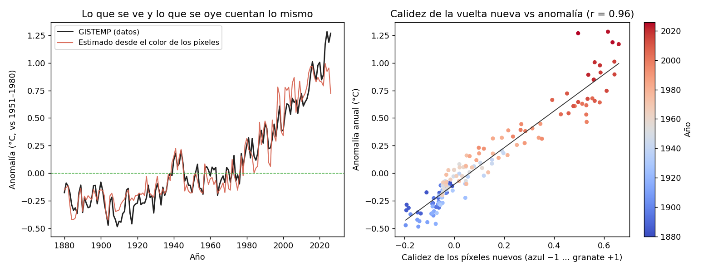

# Proceso creativo y técnico

Aquí se documenta el porqué de cada decisión y los resultados de las pruebas. Se va completando paso a paso.

## Decisiones de diseño

- **Frase guía y mapeo v1:** ver [README](../README.md).

## Datos (Paso 2)

Fuente: GISTEMP v4, descargado el 14-nov-2026. Son 1762 meses, de 1880-01 a 2026-10.

Lo que revelaron los datos y cómo influye en el diseño:

- **El rango del tono se calcula a partir de los datos.** El mínimo es −0.81 °C (enero de 1893) y el máximo +1.55 °C (octubre de 2026), así que el rango queda en [−0.9, 1.6] °C. Con un rango fijo de −0.8 habríamos recortado el mes más frío.
- **La aceleración se ve en las medias por década:**

  | Década | Media |
  |---|---|
  | 1880s–1970s | entre −0.33 y +0.04 °C |
  | 1980s | +0.25 °C |
  | 1990s | +0.38 °C |
  | 2000s | +0.59 °C |
  | 2010s | +0.80 °C |
  | 2020s | +1.06 °C |

  En 90 años casi no hubo cambio; en los últimos 45, más de un grado.
- **Los récords se concentran al final.** De los 21 años récord, 14 son de 1980 en adelante. Por eso el earcon de récord suena escaso al principio y frecuente al final, y refuerza el mensaje de aceleración sin añadir otra variable.
- **El calentamiento supera la frase guía.** La media de 2025 menos la de 1880 da +1.37 °C. Un test comprueba que la diferencia sea mayor de 1.3 °C.

## Motor de sonido (Paso 3)

**Cambio respecto al mapeo v1: melodía anual más arpegio mensual.** El plan original era "1 año = 1 compás de 12 notas" con 146 años en unos 60 s, para coincidir con el vídeo. Hechas las cuentas, eso son unas 29 notas por segundo. A partir de unas 15–20 notas por segundo el oído deja de distinguir notas y oye una textura. Por eso el sonido se divide en dos capas:

- **Melodía anual:** una nota por año (media de sus meses), unas 2.4 notas/s a velocidad normal. Es claramente una melodía y lleva la tendencia.
- **Arpegio mensual:** los 12 meses, suave y una octava más arriba. A velocidad normal funciona como "brillo"; a velocidad lenta se oye como melodía.

**Otras decisiones:**

- **La línea base cae en la tónica.** La anomalía 0 °C suena siempre en C4 y el drone toca C2 y C3. Así, una nota consonante con el drone significa "como la media de 1951–1980", y cuanto más se aleja hacia arriba, más calor.
- **Más caliente nunca suena más grave.** Al mezclar pentatónica mayor y menor podría pasar que una nota más caliente sonara más grave. Lo comprobamos: el grado k+1 siempre es más agudo que el k en cualquier combinación de modos, y hay un test que lo verifica.
- **La mezcla mayor/menor es determinista.** Se usa un dither con la razón áurea, así que la pieza suena igual en cada reproducción y es reproducible para los jueces.
- **La campanita suena al cerrar el año récord.** Así respeta la causalidad: un año solo es récord cuando termina.
- **El lector de pantalla solo anuncia las décadas.** Anunciar cada año (2.4 por segundo) lo saturaría.

## Motor de sonido v2: más serio y tenso

**Opinión tras escuchar la v1** (commit `ebeab4a`): a la velocidad original del vídeo se entiende la subida y la frecuencia creciente de las campanas, pero el acompañamiento no transmite suficiente seriedad ni tensión.

**Cambios en la v2:**

- **Escala oscura desde el inicio.** Se pasa de "pentatónica mayor → menor" a **eólico → frigio → locrio**, entre +0.3 y +1.2 °C. Los tres modos solo difieren en el 2º grado (2→1) y en el 5º (7→6), así que la mezcla mantiene la regla "más caliente = más agudo" (hay un test que lo verifica).
- **Latido (lub-dub)** de timbal, de 54 a 144 lpm entre 0 y +1.4 °C. El tempo está en tiempo real, así que acelera igual a cualquier velocidad de reproducción. Es la metáfora de "fiebre del planeta".
- **Drone en quinta abierta** grave (C2–G2 en sierras, más un sub C1). Su filtro y su volumen crecen con la temperatura, con un crescendo general.
- **Cluster disonante:** Re♭ (2ª menor) desde +0.4 °C y Fa♯ (tritono) desde +0.8 °C. En la v1 la disonancia empezaba en +1.0 °C y era tenue.
- **Viento / presión:** ruido rosa en banda que sube de 300 a 3000 Hz por encima de +0.5 °C.
- **Timbres:** la melodía usa sierras desafinadas (tipo sección), el arpegio pasa a ser un ostinato grave y corto, y la campana es más grave e inarmónica, como un toque de alarma.
- **Mezcla:** reverb más larga, compresor y limitador.
- **Velocidad por defecto:** la original del vídeo (~25 s), que es con la que se validó la v1.

## Motor de sonido v3: tonos de la v1 + tensión de la v2

**Opinión tras escuchar la v2:** gustan la subida de tensión del final y la melodía grave de fondo, pero **no la distorsión**. La v1 sonaba mejor.

**Combinación en la v3:**

- **De la v1** (timbres limpios): melodía en triángulo, arpegio pulsado agudo, drone en ondas seno (C2–C3), campanita aguda y escala pentatónica mayor → menor (+0.5 a +1.0 °C).
- **De la v2** (tensión): latido que se acelera (54 → 144 lpm), crescendo del drone y de la melodía, y el ostinato grave de fondo, ahora en triángulo.
- **Disonancia sin distorsión:** el cluster (Re♭ desde +0.4 °C, Fa♯ desde +0.8 °C) se hace con ondas triangulares filtradas. Re♭3 contra Do3 produce un batido de unos 8 Hz: tensión por roce, no por suciedad.
- **Eliminado** (fuentes de distorsión): sierras desafinadas, ruido del "viento" y compresor.

## Accesibilidad e interfaz (Paso 6)

**Modos:**
- **Historia:** de 1880 a hoy, con la espiral. Las flechas ←/→ saltan una década; si está detenida, eligen el año de inicio.
- **Explorar:** un año a 3 s, de modo que sus 12 meses suenan a 0.25 s cada uno y se oyen como melodía. Antes se dice el valor exacto. Se elige con flechas o con un deslizador nativo (`input type=range` con `aria-valuetext`).
- **Comparar:** la década de 1880 frente a la de 2010, con narración y la diferencia final dicha en voz.

**Sin voz y sin leyenda interactiva (decisiones tras probarlas).**

1. **Voz sintetizada.** La primera versión usaba la voz del navegador (Web Speech API) para una leyenda sonora (tecla L), los valores (tecla V) y la narración de Comparar. Se descartó porque sonaba robótica, tardaba demasiado en explicar y quitaba atención a la música.
2. **Leyenda y valor sin voz.** La segunda versión mostraba frases cortas mientras sonaba cada ejemplo, y V mostraba el valor. Tampoco convenció, así que **L y V se eliminaron**.

3. **Intro breve en inglés (versión final).** Se pidió recuperar la explicación con tres condiciones: que salga al pulsar Reproducir, que esté en inglés y que dure poco. Así funciona:
   - Antes de la Historia desde 1880 suenan 8 frases de 4 a 7 palabras, una por capa ("Melody: higher means warmer.", "Heartbeat: faster means hotter."…).
   - Cada frase se dice **a la vez** que suena su ejemplo, no después, así que la intro dura unos 15 s.
   - Se puede saltar con el botón "Skip intro" o con Espacio, y desactivar en Ajustes.
   - La página prefiere las voces más naturales del sistema (Google, Microsoft Natural, Samantha…). En Linux solo hay espeak-ng, que suena robótica; en Mac, Windows o Chrome la calidad es mucho mejor.
   - La frase también aparece en pantalla y llega al lector de pantalla.

**Resultado:** la experiencia se centra en la música. El significado de cada sonido queda en la lista "Cómo escucharlo" de la página, que es HTML semántico y accesible con lector de pantalla. Los mensajes breves (cambio de modo, año elegido en Explorar, resultado de Comparar) siguen yendo a una región `aria-live`, para que el lector de pantalla del usuario los lea con su propia voz. Mientras suena la Historia no se anuncia nada: la música manda.

**Teclado:**
- Espacio, ←/→, ↑/↓, M y H.
- Los atajos no interceptan las teclas que ya usa el control enfocado: Espacio en un botón, flechas en un radio o en el deslizador.
- Visible en la página como lista `<dl>`.

**Movimiento reducido:** con `prefers-reduced-motion` el vídeo no se anima; muestra el fotograma del año y se actualiza una vez por década.

**Verificación automática:**
- **axe-core 4.10** sobre el HTML (jsdom): 0 violaciones y 39 reglas superadas. Avisos revisados a mano:
  - landmark `main` y `h1`: existen; es una limitación de jsdom;
  - subtítulos del vídeo: no aplica, el vídeo no tiene audio;
  - varias etiquetas en un campo: falso positivo, los radios van dentro de su `<label>`.
- **Contraste WCAG**, calculado: todos los pares superan AAA (≥ 7:1). Texto 17.2:1, secundario 10.4:1, acento y botón 10.6:1, foco 13.1:1.
- **Lighthouse:** no se pudo ejecutar porque no hay Chrome en el equipo de desarrollo. Se sustituye por axe-core más la revisión manual con teclado y con el lector Orca.

## Capa de fotogramas y validación (Paso 7)

**Objetivo:** demostrar que lo que se ve (los fotogramas de la Climate Spiral) y lo que se oye (los datos de GISTEMP) cuentan lo mismo, y sonificar los fotogramas directamente, como pide el reto.

**Método** (`scripts/frame_features.py`):

1. Se decodifica el vídeo a 540×540 con ffmpeg.
2. Para cada año se toma el fotograma en el que termina de dibujarse y se compara con el del año anterior.
3. Los píxeles que se iluminan dentro del anillo de la espiral son la **vuelta nueva**. Se excluyen el centro, donde está la etiqueta del año, y el borde, donde están los meses.
4. Se mide su **calidez**: `signo(R − B) · (255 − G) / 255`.

La primera medida, "rojez" (R − B), daba r = 0.92 pero **se saturaba desde el año 2000**: la paleta pasa de rojo a granate, se oscurece, y R − B deja de crecer. En cambio, el verde baja siempre al alejarse del blanco, hacia el azul o hacia el rojo, y el signo de R − B indica el lado, así que la calidez crece de forma monótona del azul al granate.

**Resultado:** correlación entre la calidez de los píxeles y la anomalía anual **r = 0.96** en los 147 años. Hay un test (`pytest`) que exige r > 0.9.

**Limitación:** en 2023–2026 la estimación a partir de píxeles queda por debajo del dato. La paleta llega a su color más oscuro (no puede ser "más granate") y 2026 es un año incompleto, con menos píxeles nuevos.

**Capa sonora "frames":** un acorde agudo y limpio (Do5–Sol5 en triángulo) con trémolo. La calidez del color de cada vuelta controla su volumen y la velocidad del trémolo, de 1.5 a 10 Hz: de un brillo tranquilo a una agitación. Es la única capa que sale de los **píxeles** y no del CSV.

## Pistas extra: CO₂ y hielo ártico (Paso 8)

**Un solo motor para varias pistas: la escala de "estrés".** Cada pista traduce su valor a la escala de la temperatura (estrés de 0 a 1.4) con `sound.stressZero` y `sound.stressFull`. Así reutiliza exactamente los mismos umbrales de tensión que ya se validaron de oído: escala menor, roce de 2ª menor, tritono, latido y crescendo. El **tono** sigue al valor de cada pista (más valor = más agudo); la **tensión** sigue al estrés.

| Pista | Datos | Tónica (drone) | Estrés 0 → 1.4 | Campanita |
|---|---|---|---|---|
| Temperatura | GISTEMP v4, anomalía mensual 1880–2026 | 0 °C (media 1951–1980) | 0 → +1.4 °C | año récord de calor |
| CO₂ | NOAA GML Mauna Loa, mensual 1958–2026 | 350 ppm (nivel "seguro") | 315 → 425 ppm | hito cruzado: 325 (1970), 350 (1988), 375 (2003), 400 (2015), 425 ppm (2025) |
| Hielo ártico | NSIDC Sea Ice Index v4, anomalía mensual vs 1981–2010, 1979–2026 | 0 (media 1981–2010) | 0 → **−2** millones de km² | año récord de **mínimo** |

Decisiones:

- **CO₂: campanita por hito, no por récord.** Casi todos los años son récord de CO₂, así que una campana anual sería ruido. Los hitos de 25 ppm conservan el significado de "algo importante pasó".
- **Hielo: la tensión crece cuando el valor baja.** Con `stressFull < stressZero`, menos hielo da más tensión, latido más rápido y más brillo. En cambio el tono baja: la melodía se hunde a medida que el hielo desaparece, que es intuitivo. Hay un test que lo comprueba.
- **Hielo: anomalías y no extensión bruta.** La extensión cambia de unos 15 a unos 4 millones de km² cada año por las estaciones, y ese ciclo taparía la tendencia. Las anomalías respecto a la media de cada mes muestran la pérdida.
- **Hueco conocido:** faltan dic-1987 y ene-1988 por un fallo del satélite de la época. Se omiten.

**Visualizaciones:**

- **CO₂ (SVS 5119, OCO-2 and Keeling Curve):** el vídeo dibuja 2015–2023 y luego se aleja hasta 1958, así que **no es cronológico** y no se puede sincronizar por tiempo. Se usa su **último fotograma** (la curva completa 1958–mar 2023) con un **cursor** que se desliza hasta el año que suena. Las marcas del eje (1960…2020) se midieron en píxeles: 259, 476.5, 715.5, 933, 1150.5, 1389.5 y 1607, con mar-2023 en 1676. No son equidistantes, así que se interpola por tramos. Después de mar-2023 (el fin de la imagen) el cursor se queda al final.
- **Hielo (SVS 5395, Annual Arctic Sea Ice Minimum Area 1979–2024):** el EIC no tiene una visualización de hielo de varias décadas. Esta es del mismo estudio (SVS). Para calibrarla se siguió **automáticamente el punto rojo más a la derecha** del gráfico en cada fotograma: 1979 aparece a 4.45 s, 2024 a unos 40 s, y el avance es lineal (0.789 s/año, 13.7 px/año). Los datos llegan hasta 2026; a partir de 2024 el vídeo queda fijo.

**Velocidad:** ahora se elige por duración total (25 s, 1 min, 2.5 min, 5 min) y cada pista ajusta sus segundos por año según cuántos años tiene.

## Vídeo y calibración

Vídeo: [SVS 5190](https://svs.gsfc.nasa.gov/5190/), versión en español en °C. El original es de 2160×2160, 60 fps y 30 s (1800 frames). Para la web se convierte a 1080×1080 con `scripts/prepare_video.py`.

Calibración, medida a partir de frames extraídos con ffmpeg (una hoja de contactos de 1 frame por segundo y recortes cada 0.1 s del final):

| Tiempo del vídeo | Año en pantalla |
|---|---|
| 0 s | 1880 |
| 15 s | 1974 |
| 19 s | 1999 |
| 23.0 s | 2024 |
| 23.3 s | 2026 |
| 23.7–24 s | la etiqueta se desvanece y empieza el giro de cámara al cono 3D (hasta 30 s) |

- **Ritmo:** el avance es lineal, unos 0.1597 s por año (6.26 años/s).
- **Sincronía:** manda el audio. El vídeo se reproduce a `secondsPerYear / yearDuration` (0.39x a velocidad normal, que con 60 fps se ve fluido) y se corrige cada año si se desfasa más de 3/4 de año. Al terminar los datos, el giro al cono se reproduce a velocidad normal mientras se apaga el drone.

## Tests de escucha

_Pendiente (Paso 4)._
